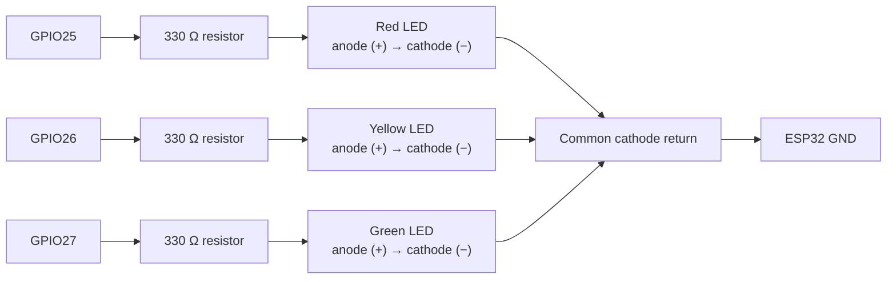

# Electronics assembly

The [firmware](../firmware/README.md) drives three ordinary two-lead LEDs from the ESP32's 3.3 V GPIO outputs. The ESP32 board and its existing battery holder sit in the [printable base](../enclosure/README.md); only the LEDs and their insulated wires go in the light head and hollow pole.

## Parts

- Bluetooth fob; [example shutter remote listing](https://www.amazon.eg/-/en/Bluetooth-Remote-Control-Mobile-Camera/dp/B0BXQP9815). Follow the [remote setup instructions](../firmware/README.md#using-another-remote) for your fob
- ESP32-WROOM-32 development board with an attached single-18650 battery holder and power switch, like [this board](https://www.aliexpress.com/item/1005008881707615.html)
- One rechargeable **18650 Li-ion cell, 3.6–3.7 V nominal, 4.2 V fully charged**, for portable use; check whether it is included with the board
- Micro-USB **data** cable for firmware upload and USB power
- Red, yellow, and green two-lead LEDs
- **Three 330 Ω resistors**, one for each LED
- Four insulated conductors long enough to pass through the pole, plus service slack at both ends (or three insulated LED pairs)
- Heat-shrink tubing or equivalent insulation for every exposed joint
- Optional removable four-pin connector between the base and pole

## Board and battery

Use the linked board as a reference for the hardware style, rather than a guarantee that every seller option is identical. This project uses the **original ESP32 / ESP32-WROOM-32 with 4 MB flash**, micro-USB, a battery holder, and an on/off switch. Select the ESP32 version if the listing also offers ESP8266 / ESP-WROOM-02 boards. The firmware configuration is in the [firmware guide](../firmware/README.md); the enclosure was designed around an approximately **30 × 90 mm board** with its holder attached.

### Choosing the cell

| Property | Requirement |
| --- | --- |
| Quantity and chemistry | One rechargeable 18650 Li-ion cell intended for 4.2 V charging |
| Voltage | 3.6–3.7 V nominal; 4.2 V when fully charged |
| Size | Approximately 18 mm diameter × 65 mm long for a bare cell; check the actual cell and holder dimensions |
| Terminals and fit | Confirm flat-top or button-top compatibility. Protected cells can be longer; do not force a cell into the holder |
| Capacity | The mAh rating affects runtime, not the required voltage. Runtime and a minimum capacity have not been measured for this project |

An AA battery, a 3.2 V LiFePO4 cell, or a two-cell series pack is not a substitute. Use the board's holder, matching its **+ / − markings**; do not wire the cell directly to the ESP32's `3V3` pin. For background on nominal versus charging voltage and cell protection, see [Adafruit's Li-ion battery guide](https://learn.adafruit.com/li-ion-and-lipoly-batteries?view=all).

### Charging and protection

Boards of this style are sold with onboard USB charging; for example, [diymore describes an ESP32/18650 board with charging and protection circuitry](https://www.diymore.cc/collections/esp32). **The charger, protection circuitry, and charging behaviour of this project's particular board have not been verified.** Check the documentation for the board you receive before charging through USB or running it while charging; do not assume another seller's charge current, indicator colours, or protection features apply.

Use a cell and board combination with documented overcharge, over-discharge, and short-circuit protection. If the onboard charger cannot be confirmed, remove the cell and charge it in a compatible external **4.2 V Li-ion charger**. An external charger does not provide protection while the cell is powering the board. Keep the cell's insulating wrap intact, avoid shorting its terminals, and charge under supervision. See [Adafruit's cell handling and charging notes](https://www.adafruit.com/product/1781) for general guidance; that wired battery pack is not a drop-in recommendation for this holder.

## Wiring

| Light (top to bottom) | ESP32 GPIO | Board label |
| --- | --- | --- |
| Red | GPIO25 | `25` |
| Yellow | GPIO26 | `26` |
| Green | GPIO27 | `27` |

These are GPIO numbers printed on the board, not positions counted along the pin header. Use the diagram below for the complete circuit.

Connect all three LED **cathodes (−)** to a common wire that returns to **GND** on the board. The longer LED leg is usually the anode; the shorter leg and flat edge of the rim usually identify the cathode. If a leg has been trimmed, check polarity before soldering. Each LED needs its **own** resistor. The resistor may be at either end of that LED's series path; placing them in the base keeps the pole wiring simpler.

Do not connect an LED directly across a GPIO pin and GND without its resistor, and do not connect these LEDs directly to the battery.

## Assembly checks

1. Disconnect USB power, turn the battery switch off, and remove the cell before wiring. Label and run four insulated wires through the pole: red LED, yellow LED, green LED, and common GND. Keep a service loop inside both the base and head so either can open without pulling a joint. Pass the wires through before attaching any connector too large for the pole's bore.
2. Solder or securely connect the resistors and LEDs. Install red at the top of the head, yellow in the middle, and green at the bottom. Insulate each exposed leg and splice separately so the wires cannot touch when the head is closed. Keep them clear of screws and mating surfaces.
3. Before installing the electronics lid, inspect for solder bridges or damaged insulation. Verify that each signal wire reaches only its intended LED/resistor path, and that the common return reaches GND.
4. Power the board and follow the [firmware verification sequence](../firmware/README.md#verify-the-light-sequence) before closing the case. Turn power off before adjusting any wiring.

Keep the existing holder, switch, and USB connection as supplied; do not add an external battery connection based only on the case drawing.
